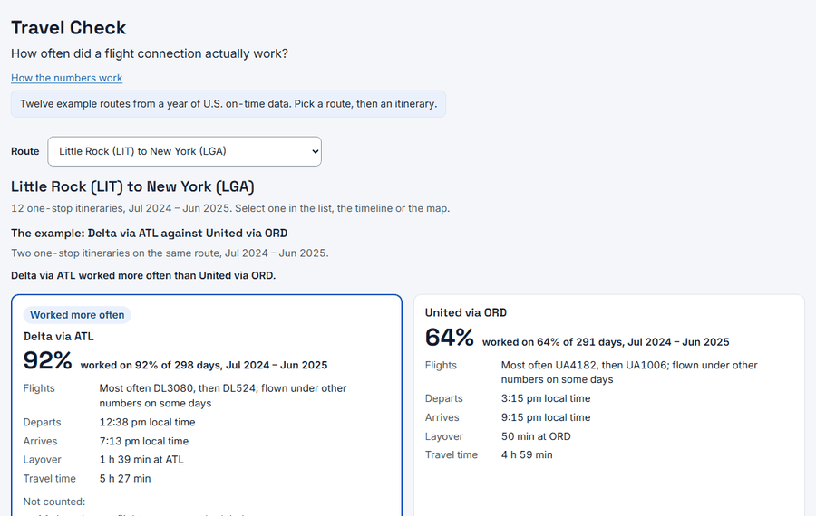

# Travel Check

A map-first explorer that compares how reliable flight itineraries are, using real historical on-time data: not only how long a trip takes, but how often its connection would actually have worked.

**Live: https://chrisbarreras.github.io/travel-check/**



**Status: Phase 0, the data feasibility experiment, is complete; the decision is GO.** Before building any interface, the project checked whether public flight data shows meaningful differences in connection feasibility between itineraries a traveler would otherwise consider equivalent. It does: 81 showcase examples in 9 origin/destination pairs across 5 hubs, from July 2024 to June 2025 (decision in [ADR-0012](docs/adr/0012-phase0-go-no-go.md); full report in [reports/phase0/summary.md](reports/phase0/summary.md)). The Phase 0 results are frozen at the git tag `phase0-final`.

**Phase 1, the static showcase explorer, is complete** (live at the link above).
- **Showcase data pipeline (complete):** builds the curated, validated JSON the explorer loads ([spec](specs/002-showcase-data-pipeline/spec.md)). It has schedule-based itinerary identity, per-day data for a transfer-time slider, and traveler insights.
- **Web foundation (complete):** the React app, its automated tests and CI, and the deployment to GitHub Pages; the landing view shows one real comparison, with every rate's sample, period and definition ([spec](specs/003-web-foundation/spec.md)).
- **Explorer core (complete):** all 12 showcase routes in three linked views, a map of curved paths through each hub, an itinerary list and a timeline, with the selection in the address so any view can be linked ([spec](specs/004-explorer-core/spec.md)).
- **Explorer insights (complete):** a transfer-time slider that recomputes each rate in the browser from the published daily data, a reliability meter, failure bar and monthly view with disruption notes, traveler-insight panels (faster alternatives, better connecting flight, buffer), a "Find this itinerary" link, and a "How the numbers work" page ([spec](specs/005-explorer-insights/spec.md)).
- **Next:** Phase 2, the API and search across all covered routes. See the [roadmap](docs/roadmap.md).

## How the numbers work

- **Data:** U.S. Bureau of Transportation Statistics on-time records for every scheduled flight, July 2024 to June 2025, and the DB1B ticket sample for which one-stop routings are actually sold.
- **Itinerary:** an airline's one-stop routing identified by its schedule (route and departure-time window), so it survives flight renumbering.
- **"Worked":** on each day both flights were scheduled to connect, the actual time from the inbound flight's gate arrival to the outbound flight's gate departure was at least the transfer time (by default the published minimum connection time) plus a 15-minute boarding cutoff. A cancelled or diverted leg counts as not working.
- **Rate:** the share of those days that worked, always shown with its number of days and period. Fewer than 30 days shows "insufficient data", not a rate.
- **Comparisons** between itineraries carry a 95% bootstrap interval. The data has no passenger records, so this measures whether the connection was feasible, not what happened to travelers.

Full definitions: the site's "How the numbers work" page and [docs/methodology.md](docs/methodology.md).

## Run the Phase 0 pipeline

Requires [uv](https://docs.astral.sh/uv/) (it installs Python 3.13) and about 6 GB of disk space (each DB1B quarter is extracted to about 2 GB while it is processed, then deleted).

```bash
cd pipeline
uv sync
uv run pytest                                            # unit and end-to-end tests, no network
uv run flight-pipeline run --config ../config/phase0.toml   # download, analyze, report
uv run flight-pipeline verify --config ../config/phase0.toml  # rerun and compare with the committed results
```

Every input is pinned by checksum in [config/phase0.toml](config/phase0.toml), so `run` reproduces the committed numbers exactly. Details: [quickstart](specs/001-bts-connection-experiment/quickstart.md). The analysis notebook (`uv run marimo edit ../notebooks/phase0_connection_experiment.py`) only reads the pipeline's outputs.

## Build the Phase 1 showcase data

The same data and pipeline, with [config/phase1.toml](config/phase1.toml) (the default). Generating the TypeScript types also needs Node.js 20 or later.

```bash
cd pipeline
uv run flight-pipeline run --no-acquire    # every stage, through curate, insights and publish
uv run flight-pipeline schemas            # JSON Schema and TypeScript types into shared/
uv run flight-pipeline verify             # rerun and compare every output byte for byte
uv run flight-pipeline schemas --check    # what CI runs: fails when shared/ is stale
```

The explorer reads `site-data/showcase/`; the data contract is [contracts/outputs.md](specs/002-showcase-data-pipeline/contracts/outputs.md), and every published definition links to [docs/methodology.md](docs/methodology.md#phase-1-showcase-data-feature-002-showcase-data-pipeline). Details: [quickstart](specs/002-showcase-data-pipeline/quickstart.md).

## Run the web app

Requires Node.js 24 (see [web/.nvmrc](web/.nvmrc)). The browser tests also need Docker, because screenshots are compared only inside the pinned Playwright image.

```bash
cd web
npm ci
npm run dev                  # local development server
npm run lint && npm run typecheck && npm test   # static checks, unit and component tests
npm run build && npm run size                   # build (data copied unchanged) and budgets
npm run test:browser:docker  # end-to-end, visual, accessibility and keyboard tests in Docker
npm run lighthouse           # performance and accessibility budgets (needs Chrome)
npm run test:visual:update   # rewrite the visual references, then review the image diffs
```

Every command and CI job is listed in [contracts/checks.md](specs/003-web-foundation/contracts/checks.md). The page loads data only through `web/src/data/`, which validates each file against the generated schema ([docs/architecture.md](docs/architecture.md)).

## Repository map

| Path | Contents |
|---|---|
| [docs/roadmap.md](docs/roadmap.md) | Phases 0–5 and their features |
| [docs/methodology.md](docs/methodology.md) | How every number is defined and computed |
| [docs/design.md](docs/design.md) | Visual and interaction direction for the explorer |
| [docs/adr/](docs/adr/README.md) | Architecture decision records |
| [specs/](specs/) | Spec Kit feature specifications, plans, tasks and reviews |
| [pipeline/](pipeline/) | Python data pipeline (`flight_pipeline`) and its tests |
| [web/](web/) | The Travel Check web app (React, TypeScript, Vite) and its tests |
| [docs/architecture.md](docs/architecture.md) | System overview and data flow |
| [reports/phase0/](reports/phase0/) | Committed Phase 0 results, data-quality counts and run manifest |
| [reports/phase1/](reports/phase1/) | The Phase 1 rerun's results with schedule-slot itineraries |
| [site-data/showcase/](site-data/showcase/) | Published showcase JSON for the explorer, with its manifest |
| [shared/](shared/) | The data contract shared by the pipeline and the explorer: JSON Schema, generated TypeScript types, shared test cases |
| [notebooks/](notebooks/) | marimo analysis notebook |

The project follows spec-driven development with [GitHub Spec Kit](https://github.com/github/spec-kit) under the rules in [.specify/memory/constitution.md](.specify/memory/constitution.md).

## Data and attribution

- Flight data: U.S. Department of Transportation, Bureau of Transportation Statistics (TranStats): Marketing Carrier On-Time Performance, T-100 Domestic Segment (U.S. Carriers) and the Airline Origin and Destination Survey (DB1B Market).
- Airport time zones: [airportsdata](https://github.com/mborsetti/airportsdata), MIT License, Copyright (c) 2020- Mike Borsetti (includes data Copyright (c) 2014 mwgg).
- Time-zone rules: tzdata, Apache License 2.0.

Results describe **connection feasibility** from historical schedules and actual gate times. They are not predictions, and they do not describe what happened to any traveler.

## Licence

Copyright (c) 2026 Christopher T. Barreras Consulting. All rights reserved. The code and documentation are published for viewing only; see [LICENSE](LICENSE). Third-party data and software keep the licences listed above.
